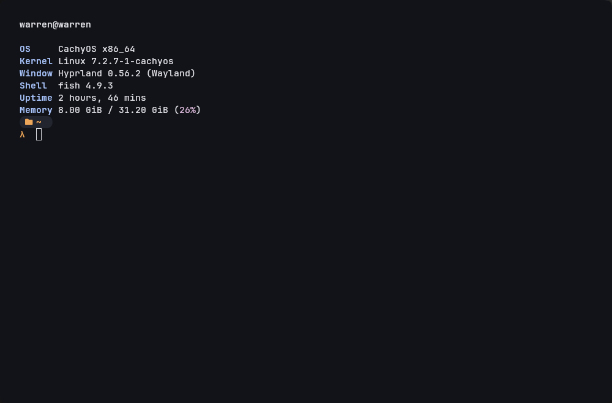

# fastfetch-minimal

A minimal, monochrome fastfetch configuration.

## Preview

## Usage

Copy `config.jsonc` to `~/.config/fastfetch/config.jsonc`, then run `fastfetch`.

No logo, monochrome palette, only the essentials: OS, Kernel, WM, Shell, Uptime, Memory.
